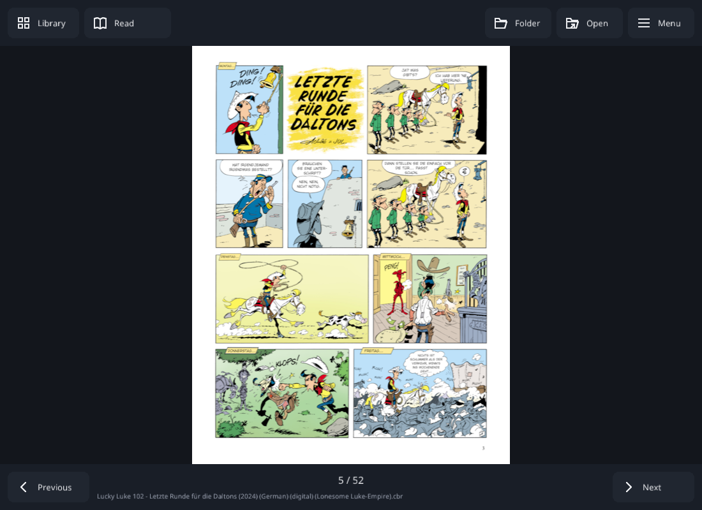
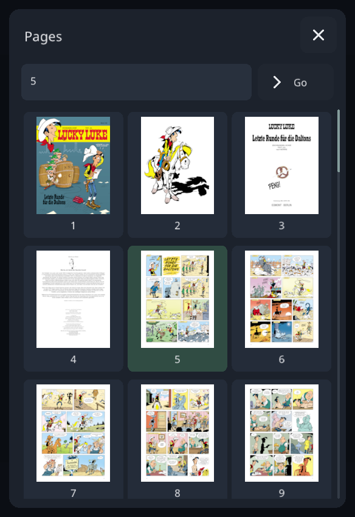

# one:am

[](https://github.com/varnholt/oneam/actions/workflows/build.yml?query=branch%3Amaster)

[**Try in your browser**](https://varnholt.github.io/oneam/) · [**Download a release**](https://github.com/varnholt/oneam/releases)

A small comic reader for Windows, Linux, macOS, Android and the browser. The reader uses C++23,
SDL3 and one 7-Zip archive backend, both built from pinned source. Qt and bit7z
are removed; no user-installed archive utility or plugin is required.

Open a book, turn the page, and return to the same place next time. Reading and
image decoding run in the background. Adjacent pages are prefetched into a bounded
cache, and resizing reuses the current image instead of extracting it again.
Reduced pages use background Mitchell filtering in linear light to prevent jagged
text and line art. The original pixels remain available for zooming, and both
rendering axes always use the same scale to preserve the page's aspect ratio.



## Downloads

Versioned binaries and SHA-256 checksums are on the [Releases page](https://github.com/varnholt/oneam/releases).
Release downloads do not require signing in. Choose your operating system and architecture,
then extract the desktop ZIP and keep its files together. Android downloads are debug-signed APKs.

For development builds, open the [latest successful master build](https://github.com/varnholt/oneam/actions/workflows/build.yml?query=branch%3Amaster+is%3Asuccess)
and download a package under **Artifacts**. GitHub requires signing in to download
Actions artifacts. Unzip desktop packages and keep their files together.

| Platform | Artifact |
|---|---|
| Windows x64 | `oneam-Windows-x64` |
| Windows ARM64 | `oneam-Windows-arm64` |
| Linux x64 | `oneam-Linux-x64` |
| Linux ARM64 | `oneam-Linux-arm64` |
| macOS Intel | `oneam-macOS-x64` |
| macOS Apple Silicon | `oneam-macOS-arm64` |
| Android ARM64 phones/tablets | `oneam-Android-arm64-v8a-debug` |
| Android x86_64 / emulators | `oneam-Android-x86_64-debug` |
| Browser / self-hosting | `oneam-WebAssembly` |

Android packages contain an installable debug APK.

## Reading

- Open **CBZ/ZIP, CBR/RAR, CB7/7z or CBT/tar** through **Open**, or drop a book onto
  the desktop window. Archive contents are read in memory, never unpacked onto disk.
- JPEG, PNG, BMP and GIF pages are supported. Animated GIFs display their first frame.
- Pages sort naturally: `page2` precedes `page10`, including uppercase extensions.
- The shelf shows recently opened books. Desktop **Folder** adds books from a
  directory and remembers that folder; the scan and visible cover loading happen
  in the background.
- Reading position is saved after a page loads. Settings live in the operating
  system's per-user application data directory, independently of the working directory.

| Action | Desktop | Touch |
|---|---|---|
| Open a book | Open / Ctrl+O | Open |
| Next / previous page | Bottom buttons; Right / Left, Page Down / Up, Space | Bottom buttons, swipe or tap a page edge |
| First / last page | Menu; Home / End | Menu |
| Scroll / pan | Wheel, Up / Down, drag | Drag |
| Zoom | Menu; Ctrl+wheel, + / - | Menu or pinch |
| Reset zoom | Menu; 0 | Menu |
| Fit page / fit width | Menu; W | Menu |
| Hide / show bars | Read, Menu or Tab; click the page center | Menu or tap the page center |
| Shelf | Library or Escape | Library or Android Back |
| Select a shelf book | Arrow keys, Enter | Tap a cover |
| Fullscreen | Menu; F11 | Menu |
| Help | Menu's help button; F1 | Menu's help button |
| Page browser / go to page | Menu; G | Menu, then tap a thumbnail or page-number field |
| Single / two-page / continuous | Menu | Menu |
| Manga / cover offset / trim margins | Menu | Menu |
| Bookmark current page | Menu; B | Menu |
| Browse bookmarks | Menu | Menu |
| Rotate clockwise | Menu; R | Menu |
| Brightness / contrast / gamma | Menu → Image adjustments | Menu → Image adjustments |
| Next book / automatic next book | Menu | Menu |
| Search library | Search field; Ctrl+F | Search field |
| Sort / filter / mark read or unread | Shelf Menu; right-click a cover to select it | Long-press a cover, then Menu commands |

All keyboard commands have visible mouse and touch equivalents. The shared
controls menu scrolls on small screens, and its help and close buttons stay fixed.
A floating **Controls** button stays available when the bars are hidden. Escape
or Android Back restores the bars before returning to the shelf.
Buttons use vector icons, clear disabled/active/hover states and touch targets
of at least 48 logical pixels. No icon fonts or image libraries are required.

Two-page mode can keep the cover alone or pair it with the next page. Manga mode
reverses the spread order, left/right arrows, edge taps and swipe direction.
Continuous mode fits pages to the available width and scrolls across page boundaries;
only neighboring pages are loaded, rather than stitching an entire book into memory.

Margin trimming conservatively removes plain near-white or transparent borders,
retaining a safety margin. It is reversible and never changes an archive. Rotation
and brightness/contrast/gamma adjustments are also display-only. Each book remembers
its layout, manga direction, cover offset, zoom, rotation, trimming, fit mode,
hidden controls and image adjustments. Switching books restores that book's own
preferences; new books start with the default view. Library sort/filter choices
and automatic next-book navigation are global preferences.

The shelf shows unread, in-progress and finished states, with progress percentages.
Search matches titles and filenames using Unicode case folding. Sort by title,
recently opened or reading progress; filter by reading state. Marking a book unread
also resets its saved position. Right-click or long-press selects a book without
opening it. Next-book navigation follows natural filename order in the current
collection, independently of the shelf's filter. With **Auto next book** enabled,
turning forward beyond the final page opens the next book; it never wraps around.

Embedded `ComicInfo.xml` provides title, series, issue, writer, summary and manga
direction. See **Menu → Book information**. Missing or malformed metadata falls
back to the filename. Metadata is read locally without fetching external resources.



## Desktop build

Requires CMake 3.22+, a C/C++ toolchain with C++23 `std::expected`, and internet
access on the first configure. MSVC 2022, GCC 14, or Clang with a recent libc++ or
libstdc++ are suitable. Dependency source revisions are pinned in `CMakeLists.txt`.

```sh
cmake -S . -B build -DCMAKE_BUILD_TYPE=Release
cmake --build build --config Release --parallel
ctest --test-dir build -C Release --output-on-failure
cmake --install build --config Release --prefix artifacts/oneam
```

Run `artifacts/oneam/oneam` (Windows: `oneam.exe`) and keep the packaged files together,
including `assets/` and the `oneam_archive` shared library.
On Linux, install the development packages for X11 or Wayland and OpenGL first;
the CI workflow lists the Ubuntu packages.

## Android APK

The same C++ reader is built as an SDL Android application. It uses the system
document picker and `content://` streams; broad storage access is not required.
Read permissions are persisted when the document provider supports it. A provider
that revokes permission requires choosing the book again.

Requires JDK 21, SDK platform 36, NDK `27.1.12297006`, and Android CMake `3.22.1`.
Set `ANDROID_HOME` to the SDK directory, then:

```sh
python scripts/prepare_android.py
cd android
./gradlew assembleDebug
```

On Windows use `gradlew.bat`. The checksum-verified wrapper downloads Gradle 8.13.
The installable APK is `android/app/build/outputs/apk/debug/app-debug.apk`.
The default architecture is ARM64; add `-PoneamAbis=arm64-v8a,x86_64` for an APK
that also runs on an x86_64 emulator. Minimum Android version: 8.0 (API 26).

The GitHub Actions workflow builds the desktop and Android targets listed above
on pushes, pull requests and manual runs. Each desktop target runs the regression
suite; Android builds ARM64 and x86_64 APKs independently.
Debug APKs use optimized native decoding and are suitable for testing and sideloading. Release signing is deliberately
left to the owner; no release credentials belong in the repository.

## Browser preview

[Open the live reader](https://varnholt.github.io/oneam/) and choose **Try a sample**,
**Open comic**, or drop a supported archive onto it. The same C++ reader runs in
WebAssembly, including background decoding, filtering and native vector controls.
The included sample comic is drawn locally and contains no downloaded artwork.

Comics are processed locally and are never uploaded. Imported books stay in the
current tab's memory, with a 256 MiB limit per file and 512 MiB total per tab.
Reading positions, bookmarks and preferences are saved in this browser's local
storage. After reloading, reselect the same comic to resume it; clearing browser
storage removes saved preferences. Private browsing or storage restrictions may
prevent persistence.

Use a recent browser with WebAssembly threads and OffscreenCanvas. GitHub Pages
uses the bundled, dependency-free service worker to supply cross-origin isolation
headers. It does not cache or upload comics. Hosts that support custom response
headers can use `web/_headers`; the reader then skips the compatibility worker.

To build and serve locally with Emscripten **6.0.1**:

```sh
emcmake cmake -S . -B build-web -DCMAKE_BUILD_TYPE=Release -DONEAM_BUILD_TESTS=OFF
cmake --build build-web --parallel
python scripts/serve_web.py build-web/web
```

Open `http://127.0.0.1:8080`. The server supplies the required isolation headers.
For self-hosting, extract the WebAssembly release ZIP and serve its directory over
HTTPS. The archive backend is a separate `oneam_archive.wasm` module; its matching
source bundle includes instructions for rebuilding and replacing it.

## Publishing releases

Builds run for every branch. The master WebAssembly build automatically deploys the
live preview through GitHub Pages. To publish a version, wait for a successful
**Build** run of the exact commit, then push its matching `vX.Y.Z` tag. The **Release**
workflow promotes those already-tested artifacts into named downloads and generates
`SHA256SUMS.txt`; it refuses missing targets or a version that does not match CMake.
Tags containing a suffix, such as `v2.0.0-beta.1`, create prereleases. The workflow
can also be rerun manually for an existing tag.

## Limits and verification

The main decoded page cache is capped at 128 MiB. Neighbor workers each have a
32 MiB cache and the page-thumbnail worker has an 8 MiB cache, with separate bounded cover textures.
Individual encoded images are limited to 64 MiB and decoded RGBA images to 96 MiB
and 16384 pixels per dimension. Current displayed images and temporary decoder
allocations are additional to the cache budget. Oversized or damaged pages report
an error instead of attempting an unbounded allocation.

Password-protected books, multipart RAR archives, WebP/AVIF/TIFF pages and PDF are
outside the supported format set. Solid RAR/7z archives can require substantial
decompression for a distant page; this remains background work. Providers that
cannot seek may not support archive formats requiring random access.

The regression suite covers ZIP/7z/tar reads, RAR4/RAR5 interoperability,
ordering, corrupt input, cache eviction, canceled requests, fast book switching,
metadata, spread pairing, image adjustments, margin detection, bookmarks and progress.
When Python is available, generated comic fixtures also exercise ten complete
application workflows with the SDL software renderer, including continuous-scroll
boundaries and automatic next-book navigation.
See [the audit](docs/AUDIT.md) for the original defects and fixes.

## Dependencies

There are two compiled third-party libraries: SDL3 for windows, rendering, input
and native file dialogs, and 7-Zip for all archive formats and compression. There
are no separate zlib, liblzma, libarchive or UnRAR dependencies. Image and font
decoding use the `stb_image`, `stb_image_resize2` and `stb_truetype` headers from the
same pinned source. Noto Sans is bundled under
the SIL Open Font License. The font was
taken from google/fonts revision `86aced91de05cd4f96a06838124cca45be337b2b`.
Third-party license notices ship in `assets/licenses/` and `assets/OFL.txt`.
The 7-Zip backend uses its normal library interface and a small stream adapter;
it is linked normally, without runtime library-path guessing or shell commands.
Its CMake recipe is adapted from Microsoft vcpkg. Matching decoder source and
a standalone rebuild recipe accompany CI artifacts as `oneam-archive-source.zip`.

## Formatting

The C++ and CMake configurations match Deceptus: `.clang-format` uses its Chromium
base with Allman braces and three-space indentation; `.cmake-format.yaml` uses
four-space indentation and a 100-column limit. Format repository C++ with
`clang-format -i src/*.cpp src/*.hpp tests/*.cpp` and CMake with
`cmake-format -i CMakeLists.txt cmake/sevenzip.cmake`.
